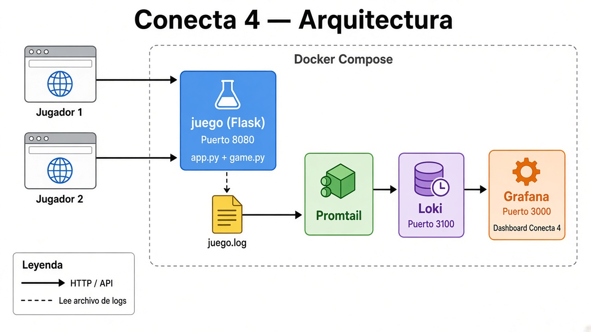

# Conecta 4

Partida de dos jugadores. Cada navegador es una sesión distinta y se encuentran con un código de sala. El servidor decide las jugadas. Docker levanta el juego, Loki y Grafana.

## Cómo clonar y arrancar (desde cero)

Sí: con Docker Desktop instalado, cualquiera puede clonar este repo y levantarlo.

```powershell
git clone https://github.com/Brajanvvs/JuegoConecta.git
cd JuegoConecta
docker compose up --build
```

Luego abre http://localhost:8080 (juego) y http://localhost:3000 (Grafana).

## Cómo correrlo con Docker (recomendado)

1. Abre **Docker Desktop** y espera a que diga que está en marcha.
2. En Cursor / VS Code, abre esta carpeta del proyecto.
3. Abre la terminal integrada: `Ctrl+ñ` o menú **Terminal → New Terminal**.
4. Confirma que estás en la raíz del proyecto (donde está `docker-compose.yml`) y corre:

```powershell
docker compose up --build
```

5. Cuando termine de construir, abre el navegador:
   - Juego: http://localhost:8080
   - Grafana: http://localhost:3000 (si pide clave: usuario `admin`, contraseña `admin`)
   - Loki: http://localhost:3100

6. Para apagarlo: en esa misma terminal `Ctrl+C` y después:

```powershell
docker compose down
```

## Cómo correrlo solo el juego (sin Docker)

Sirve para probar el tablero rápido. **No** levanta Loki ni Grafana.

1. Abre la terminal en la raíz del proyecto.
2. Activa el entorno e inicia Flask:

```powershell
.\.venv\Scripts\python.exe app\app.py
```

3. Abre http://localhost:8080

Si el entorno virtual no existe todavía:

```powershell
py -m venv .venv
.\.venv\Scripts\python.exe -m pip install -r app\requirements.txt
.\.venv\Scripts\python.exe app\app.py
```

## Cómo jugar con dos sesiones

1. Abre http://localhost:8080, escribe un nombre y pulsa **Crear sala**.
2. Abre una ventana de incógnito, o otro navegador, y entra a la misma dirección.
3. Escribe otro nombre, el código de 4 letras y pulsa **Unirse**.
4. El rojo empieza. Cada clic es una columna: la ficha cae hasta la casilla libre de más abajo.
5. Gana quien junta cuatro en horizontal, vertical o diagonal. Si el tablero se llena, es empate.
6. Al terminar aparece un cartel: **¡Ganaste!** o **Perdiste**.

La misma ventana no sirve para los dos jugadores: la sesión es una cookie llamada `conecta4`. Incógnito no tiene esa cookie, así que es otra persona.

## Qué archivo mirar

| Archivo | Qué explica |
| --- | --- |
| `app/game.py` | Reglas: gravedad, cuatro en línea, empate y la sala |
| `app/app.py` | Cookie de sesión, rutas HTTP y el evento JSON de cada jugada |
| `app/static/game.js` | La pantalla, el cartel de resultado y el poll del estado |
| `docker-compose.yml` | Los cuatro contenedores |
| `observability/` | Configuración de Loki, Promtail y el tablero de Grafana |

Las pruebas de las reglas y de las dos sesiones están en `app/test_reglas.py` y `app/test_api.py`:

```powershell
.\.venv\Scripts\python.exe -m unittest discover -s app -t app
```

Dentro del contenedor también se pueden correr: `docker compose exec juego python -m unittest`.

## Los cuatro contenedores

1. **juego** — Flask. Guarda las partidas en memoria y escribe cada evento en `/var/log/conecta4/juego.log`.
2. **promtail** — Lee ese archivo y lo envía a Loki. El juego no habla con Loki.
3. **loki** — Guarda los eventos.
4. **grafana** — Los muestra en el tablero Conecta 4, que se actualiza solo cada 5 segundos.

Si Grafana no abre, los mismos eventos están en `docker logs conecta4-juego`.

Consultas útiles dentro de Grafana, en Explore, con el origen Loki:

```logql
{app="conecta4"}
{app="conecta4", event="victoria"}
{app="conecta4", event="jugada"} | json | columna="4"
```

## Cómo decirlo

Conecta 4 es un tablero de 7 columnas por 6 filas. Dos navegadores no comparten jugador: cada uno recibe una cookie y entra a la misma sala con un código. Flask aplica la gravedad y busca cuatro en línea. Cada acción queda en un JSON. Promtail lleva ese archivo a Loki y Grafana cuenta partidas, jugadas, victorias, empates y jugadas rechazadas. Si el contenedor se reinicia, las partidas en memoria se borran; los logs quedan en el volumen de Loki.

---

## Cómo está construido



> También está en formato vectorial: [`docs/arquitectura-conecta4.svg`](docs/arquitectura-conecta4.svg)

El proyecto se divide en dos capas: **el juego** y **la observabilidad**.

### 1. El juego (carpeta `app/`)

| Pieza | Rol |
| --- | --- |
| `game.py` | Lógica pura. Tablero 6×7, soltar ficha, detectar cuatro en línea, empate, sala con dos jugadores. |
| `app.py` | Servidor Flask. Asigna cookie de sesión, crea/une salas, recibe jugadas y escribe un log JSON por evento. |
| `templates/index.html` | Página HTML mínima. |
| `static/game.js` | Interfaz: pide estado al servidor, pinta el tablero, muestra el cartel de ganaste/perdiste. |
| `static/style.css` | Estilos del tablero y del cartel. |
| `Dockerfile` | Empaqueta Python + Flask para correr dentro de Docker. |

Flujo de una jugada:

1. El navegador envía `POST /api/jugada` con la columna.
2. Flask identifica al jugador por la cookie.
3. `game.py` aplica la gravedad y busca victoria o empate.
4. Se escribe un evento JSON (jugada, victoria, empate o jugada inválida).
5. El otro navegador se entera porque pregunta `/api/estado` cada medio segundo.

Las partidas viven **en memoria** (`SALAS` en `app.py`). Si el contenedor se reinicia, las salas se borran; los logs no.

### 2. Observabilidad (carpeta `observability/` + Compose)

En el diagrama de arriba se ve el mismo flujo:

**Navegadores → juego (Flask) → `juego.log` → Promtail → Loki → Grafana**

- El juego **no** habla con Loki. Solo escribe un archivo.
- Promtail lee ese archivo y lo empuja a Loki.
- Grafana ya viene con el origen Loki y el dashboard **Conecta 4** listos (provisioning).

### 3. Orquestación (`docker-compose.yml`)

Define los cuatro servicios, los puertos y el volumen compartido de logs entre **juego** y **promtail**. Un solo comando (`docker compose up --build`) levanta todo el stack.
